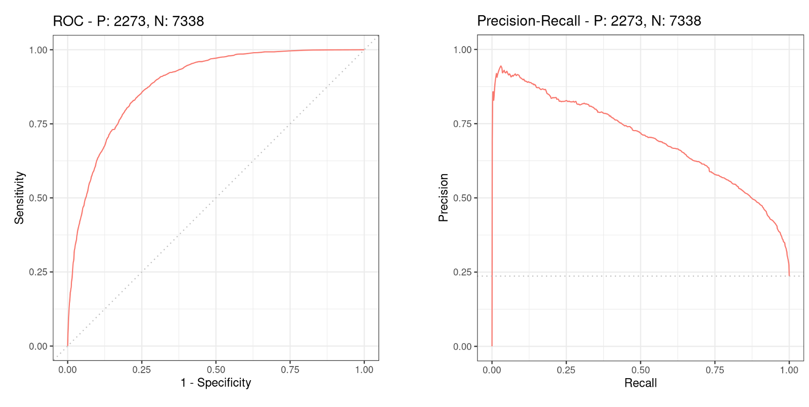

# m6APrediction

## Overview

**m6APrediction** is an R package for predicting N6-methyladenosine (m6A) RNA methylation sites using a pre-trained Random Forest model.

The package provides functions for DNA sequence encoding and m6A prediction. It supports both single-sample and multiple-sample prediction using sequence-related and genomic features.

## Installation

The package can be installed from GitHub using the `remotes` package:

``` r
install.packages("remotes")

remotes::install_github("ameyuki126-web/m6APrediction")
```

Load the package:

``` r
library(m6APrediction)
```

## Function Explanations

### 1. DNA Sequence Encoding

`dna_encoding()` converts a character vector of equal-length DNA sequences into a nucleotide encoding data frame. Each column represents one nucleotide position, with factor levels A, T, C, and G.

**Example:**

``` r
dna_strings <- c("ATGCA", "GGTAC")

encoded_data <- dna_encoding(dna_strings)

head(encoded_data)
```

**Input requirements:** - Input must be a character vector. - All DNA sequences must have the same length. - Sequences should contain only A, T, C, and G.

### 2. Loading the Pre-trained Model

Both prediction functions use the same pre-trained Random Forest model. Load the model before running the prediction examples:

``` r
ml_fit <- readRDS(
  system.file("extdata", "rf_fit.rds", package = "m6APrediction")
)
```

### 3. Single-sample Prediction

`prediction_single()` predicts the probability and classification status of m6A methylation for an individual sample.

The function uses the following input features:

-   `gc_content`: GC content of the sequence.
-   `RNA_type`: RNA type. Accepted values are `mRNA`, `lincRNA`, `lncRNA`, and `pseudogene`.
-   `RNA_region`: RNA region. Accepted values are `CDS`, `intron`, `3'UTR`, and `5'UTR`.
-   `exon_length`: Exon length.
-   `distance_to_junction`: Distance to the nearest exon junction.
-   `evolutionary_conservation`: Evolutionary conservation score.
-   `DNA_5mer`: Five-nucleotide sequence surrounding the candidate site.

**Example:**

``` r
single_result <- prediction_single(
  ml_fit = ml_fit,
  gc_content = 0.6,
  RNA_type = "mRNA",
  RNA_region = "CDS",
  exon_length = 12,
  distance_to_junction = 5,
  evolutionary_conservation = 0.8,
  DNA_5mer = "GGACA",
  positive_threshold = 0.5
)

print(single_result)
```

The function returns a named character vector containing:

-   `predicted_m6A_prob`: Predicted probability of m6A methylation, represented as a character value.
-   `predicted_m6A_status`: Predicted classification status (`Positive` or `Negative`).

### 4. Multiple-sample Prediction

`prediction_multiple()` predicts m6A methylation probabilities and classification statuses for multiple samples.

The input must be a data frame containing the following columns:

| Feature | Description |
|----|----|
| `gc_content` | GC content of the sequence |
| `RNA_type` | RNA type |
| `RNA_region` | RNA region |
| `exon_length` | Exon length |
| `distance_to_junction` | Distance to the nearest exon junction |
| `evolutionary_conservation` | Evolutionary conservation score |
| `DNA_5mer` | Five-nucleotide sequence surrounding the candidate site |

For `RNA_type` and `RNA_region`, use the accepted values described in the previous section.

**Example:**

The following example uses the pre-trained model loaded above.

``` r
# Load example input data
example_df <- read.csv(
  system.file("extdata", "m6A_input_example.csv", package = "m6APrediction")
)

# Predict m6A methylation for multiple samples
multiple_result <- prediction_multiple(
  ml_fit = ml_fit,
  feature_df = example_df,
  positive_threshold = 0.5
)

head(multiple_result)
```

The function returns a data frame containing the original input features and two additional columns:

-   `predicted_m6A_prob`: Predicted probability of m6A methylation.
-   `predicted_m6A_status`: Predicted classification status (`Positive` or `Negative`).

The default classification threshold is 0.5. Samples with predicted probabilities greater than the threshold are classified as `Positive`; otherwise, they are classified as `Negative`.

## Model Evaluation

The predictive performance of the Random Forest model can be evaluated using Receiver Operating Characteristic (ROC) and Precision-Recall (PR) curves.

The ROC curve illustrates the trade-off between sensitivity and specificity, while the Precision-Recall curve evaluates the relationship between precision and recall.

The following figure shows the model evaluation results using both curves.



## License

This package is licensed under the MIT License. See the `LICENSE` file for details.
